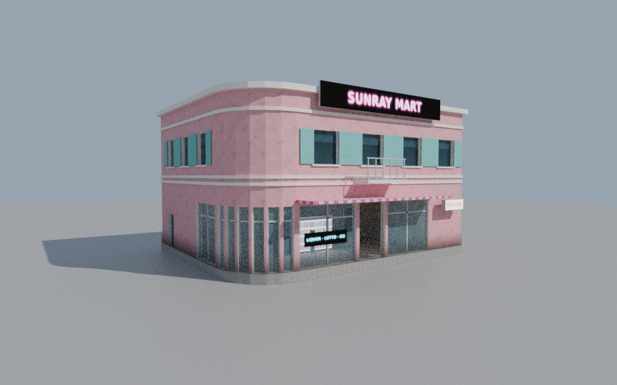
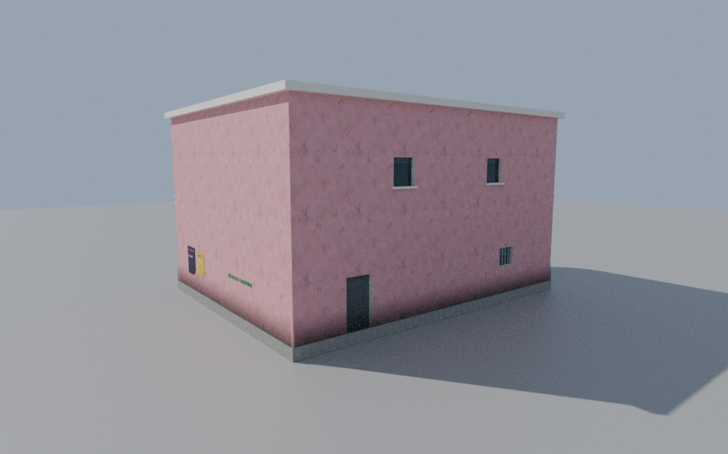
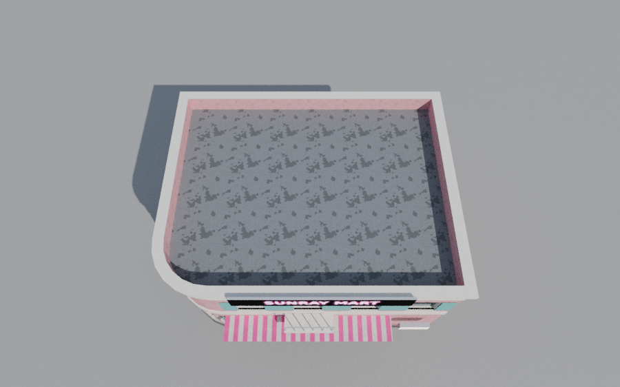

# MLO Forge: building spec → FiveM MLO

One command turns a building spec into a **FiveM resource**: an exterior with collision and LOD, plus a walk-in MLO interior (rooms, portals, props) and a shared texture dictionary.

```
specs/building_001.json ─▶ geometry + rooms + portals ─▶ DDS textures ─▶ Blender + Sollumz ─▶ read-back checks ─▶ fivem/<resource>
   (you / an LLM / later:     (forge/building.py,        (forge/textures.py,   (blender/build_in_    (forge/validate.py)   (forge/package.py)
    parsed AI references)       pure Python)               forge/dds.py)         blender.py)
                                                                                                         └─▶ build/runs.sqlite ─▶ you rate it ─▶ learning loop
```

| Front | Back | Roof |
|---|---|---|
|  |  |  |

*Preview renders of the exported scene (Cycles, stand-in materials made from the generated diffuse textures; GTA's own shaders only render in-game).*

Design and roadmap: [docs/MLO_FORGE.md](../docs/MLO_FORGE.md). GTA/MLO rules it follows: [docs/GTA_MLO_NOTES.md](../docs/GTA_MLO_NOTES.md).

## Windows quickstart

**One-time installs (all free):**
1. **Python 3.10+** (python.org, tick "Add to PATH").
2. **Blender 5.x** (blender.org).
3. **Sollumz 2.9.1:** download the zip from github.com/Sollumz/Sollumz/releases, then in Blender: Edit → Preferences → Get Extensions → ⌄ → Install from Disk.
4. In **Sollumz preferences → Dependencies**, install **PyMateria** (Cfx.re's library; accept its licence). This is what makes the export **native binary** (`.ydr/.ybn/.ytd/.ytyp/.ymap`) instead of XML.
5. **CodeWalker** (github.com/dexyfex/CodeWalker): to look at the result on the map.
6. A local **FiveM server** (FXServer + txAdmin, free key from keymaster.fivem.net).
7. Optional but recommended: **muto-atlas** for Claude Code (`claude plugin marketplace add B7Kompirine/muto-atlas`, then `claude plugin install muto-atlas@muto-atlas`). Then run its `/asset-setup` to build the data layers from *your* GTA install, so questions about vanilla props, doors and lods get measured answers.

**Then:**
```powershell
powershell -ExecutionPolicy Bypass -File forge\windows\setup.ps1          # checks Python/Blender/Sollumz/PyMateria
cd forge
python -m forge.build specs\building_001.json                             # ~20 s
powershell -File windows\install_resource.ps1 -Server C:\FXServer\server-data
```
Then restart the server and **fully reconnect**, because stream files are cached.
- **`/vm_b001`** teleports you to the front door.
- **To move the building:** stand on the ground where its front-centre should go, face the street, run **`/vm_here`**, paste the printed `"placement": {...}` into the spec, and rebuild.

> The default placement `[1700, 3260, 41]` is only a placeholder, so pick a real spot with `/vm_here` first. Until then the building may float or sink.

## Commands
| | |
|---|---|
| `python -m forge.build SPEC [--format native\|cwxml] [--overrides DIR] [--blender PATH]` | Full build. `--overrides DIR` uses `DIR/<texture_name>.png` (AI-generated swatches) instead of procedural textures |
| `python -m forge.runs list` / `rate 3 bad --tags floating_props` / `export ratings.csv` | Run history, ratings and training data |
| `blender -b build/<id>/<id>.blend --python blender/render_preview.py -- --out previews` | Turntable-style preview renders for the gallery |
| `python -m pytest -q tests` | 17 tests (geometry, portals, collision, textures, DDS, placement) |

## What's verified and what isn't

**Verified here** (Linux, Blender 5.3.0, Sollumz 2.9.1 release, CodeWalker-XML export):
- **Full build:** ~16 s. Sollumz exported 8 drawables, `vm_b001_mlo.ybn`, `vm_b001.ytyp`, `vm_b001.ymap` and `vm_b001_txd.ytd` with no errors.
- **Read-back checks pass:**
  - every archetype uses the shared texture dictionary
  - every model with collision names itself in `physicsDictionary`
  - all 7 MLO entities use flags 18350080, lodDist −1, and are attached to a room
  - the ytyp has 3 rooms (limbo first), 12 four-corner portals, and an exterior LOD at 120/500 m
  - the ymap has 10 entities and one `CMloInstanceDef`, with real extents
  - textures: 58 DDS files, 9.9 MB, power-of-two, full mip chains, DXT5 only where alpha is needed, byte-identical in the export
- **Negative test:** I deliberately broke 4 things (a ymap flag on an MLO entity, an entity detached from its room, the wrong texture dictionary, DXT1 where alpha is needed). The validator caught all 4.
- **Geometry tests:**
  - outer walls face out and interior walls face into their room
  - interior surfaces have vertex colour R = 0
  - every portal faces from its room toward the outside
  - the front entry is open in the collision, but the shop windows are solid
  - every prop sits inside its room
  - the `/vm_here` placement maths is correct for any heading

**Not verified yet:**
1. **Native binary export:** PyMateria is Windows-only. The code path is Sollumz's own, but its first run is on your PC.
2. **In-game behaviour:** walking in, portal visibility, lighting, LOD switch distances. These need the game.
3. **Portal direction:** corners wind *from the room toward the outside*, which matches the Sollumz tutorial's "inside → outside". I couldn't find this documented in CodeWalker or Sollumz source. If you can't see outside through the shop glass, select the portals in Sollumz and use **Flip Direction**, then tell me so I can fix the generator.
4. **Interior lighting:** there are no light emitters yet (vanilla interiors get their mood from lights). The fridges and signs are emissive, but rooms may look dim.

## What's next
- **Reference parsing (M1):** turn the ChatGPT/Qwen elevations from `forge/prompts/building_001.md` into the openings list automatically (SAM + Florence-2), instead of the hand-written layout in `building.py`.
- **Dressing:** interior lights and light emitters, decal shaders (`decal.sps`, bucket 2) instead of alpha quads, corner chamfers (~1.5–2 cm, measured on vanilla), a shadow-proxy mesh, more props (TRELLIS.2 kit), and the upstairs apartment.
- **Learning loop:** a gallery page for rating, plus the reward model from `runs.sqlite`.
